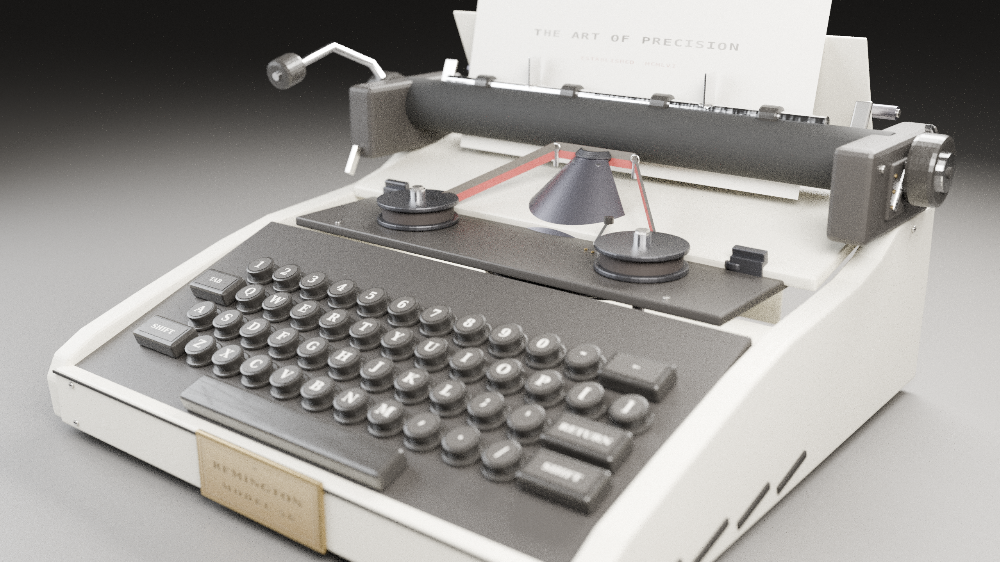

# Remington MODEL 56 — 1950s Portable Manual Typewriter

Photorealistic, fully procedural 3D asset of a fictional 1950s portable manual
mechanical typewriter ("Remington MODEL 56"), built for an industrial-design /
auction-catalogue look. All geometry is real 3D (no billboard textures), all
textures are procedural, and the whole scene is editable Blender data organised
into numbered collections.



## Deliverables

| File | Description |
|------|-------------|
| `vintage_typewriter.blend` | Organised Blender scene (metric units, m) |
| `vintage_typewriter.glb` | glTF 2.0 binary export (GLB), metres, cameras included |
| `build.py` | Procedural Blender build script (geometry, materials, cameras, lights) |
| `gen_textures.py` | Procedural texture generator (paper, badge, legends, ribbon, …) |
| `render.py` | Batch renderer with per-camera studio lighting setups |
| `validate.py` | Headless QC checks (dimensions, key count, GLB re-import) |
| `renders/` | 16 product photographs (2560×1440, macros 2200×2200) |
| `textures/` | Packed procedural textures (also embedded in the .blend / .glb) |

## Dimensions (real-world, full scale)

| Measure | Value |
|---|---|
| Total width (casing / carriage) | **310 mm** |
| Total depth (casing) | **300 mm** (304 mm at rear panel) |
| Body height (casing) | **105 mm** |
| Keyboard section | 285 × 115 mm |
| Carriage width | 310 mm |
| Platen diameter | 30 mm |
| Overall (incl. platen knobs, return lever, handle) | ≈ 356 × 337 × 255 mm |
| Height with paper | ≈ 255 mm |

The specified 310/300/105 mm envelope matches the casing and carriage exactly.
As on real portables, the platen knobs, carriage-return lever and rear handle
protrude beyond the case shell; the bounding box reported by `validate.py`
follows the outermost geometry.

## Design

Fictional 1950s portable in the spirit of the era's light-standard portables:
warm ivory enamelled steel casing with bevelled edges, curved side cheeks,
front apron with an engraved brass **REMINGTON · MODEL 56** badge, a sloped
keyboard deck, an open ribbon deck with two fabric spools, a rear mechanical
hood and a paper-table behind the platen. The machine inserts one sheet of
warm, lightly aged paper typed with **"THE ART OF PRECISION"** in a
typewriter-style face (per-character jitter, ink density variation, a red-ribbon
accent line).

### Keyboard — 50 individually modelled keys

Staggered QWERTY, round dished Bakelite keycaps with ivory legends, separate
key stems, skirts and an integrated spacebar:

- Row 1: `1 2 3 4 5 6 7 8 9 0 -` + `←` (Backspace)
- Row 2: `TAB` + `Q W E R T Y U I O P [ ]`
- Row 3: `A S D F G H J K L ; '` + `RETURN`
- Row 4: `SHIFT` + `Z X C V B N M , . /` + `SHIFT`
- Row 5: `SPACEBAR`

= **50 key objects** (each its own mesh with its own legend plate).

### Carriage, platen and paper feed

Full-width carriage rail with rack, cast carriage end-caps, black rubber platen
on chrome axles with Bakelite knobs both ends, graduated paper scale, paper
bail rod with 4 rollers, 2 adjustable paper-guide blocks + flags, adjustable
margin stops, carriage return lever (bent chrome rod, Bakelite knob, visible
return spring), paper-release lever, 3-position line-spacing selector,
rear rail with margin stops, short ivory paper table with two wire fingers.

### Ribbon and mechanism

Two fabric spools (flanged, wound ribbon, chrome hubs and hex nuts), a
black/red woven bicolor ribbon (diagonal + print-line runs), two ribbon guide
posts with eyes, ribbon vibrator fork, universal bars, 40 individually modelled
typebars in a fanned basket with slugs and nickel tips, segment rails, two
brackets, escapement wheel + pinion, 3-position ribbon selector with detents,
knurled adjustment thumb wheels, control levers and pivots.

### Microdetails

Slotted chrome screws (apron, deck, access panel, end caps, rail ends, hood),
coiled return springs, rear coil springs, hinge pins on the rear access panel,
carrying handle with leather grip, ventilation slots (sides + rear), casing
seam lines, rubber feet, engraved brass **MODEL 56** badge, rear carrying
handle, calibration dots.

## Materials (PBR, Principled BSDF)

- **Ivory enamel** — cream base, orange-peel roughness map, clearcoat 0.35
- **Black Bakelite** — near-black base, fine scratch roughness map, clearcoat 0.38
- **Brushed chrome / nickel** — metallic, streak roughness map / smooth nickel
- **Dark internal steel & blued spring steel** — metallic, mid roughness
- **Rubber** — matte black (platen, feet, bail rollers)
- **Fabric ribbon** — woven black/red bicolor map
- **Paper** — warm off-white, fibre noise, typed text (sRGB)
- **Brass badge** — brushed brass base + engraved text map
- **Leather** — handle grip

Restrained weathering only (fine scratches, speckle in the enamel); the machine
is presented as carefully maintained.

## Scene organisation

Collections (all objects assigned):

```
01_MAIN_CASING        chassis, cheeks, apron, hood, decks, feet, handle, vents
02_KEYBOARD           50 keys, legend plates, skirts, unified stem object
03_CARRIAGE           rail, rack, end caps, margin stops, return lever, margin release
04_PLATEN_AND_PAPER   platen, knobs, axles, paper sheet, scale, bail, guides, release
05_RIBBON_MECHANISM   spools, ribbon strips, guides, vibrator, brackets
06_TYPEBARS           40 typebars, segment rails, posts, universal bars, gears
07_CONTROLS_AND_LEVERS ribbon selector, line spacing selector, adjustment wheels
08_FASTENERS_AND_DETAILS screws, springs, hinges, badge
09_CAMERAS            16 cameras (CAM_01 … CAM_16) with per-camera setup tags
10_LIGHTING           world, dark/white seamless floors, 3 area softboxes
```

Object naming: `KEY_*`, `PLATEN_*`, `RIBBON_*`, `TYPEBAR_*`, `CARRIAGE_*`,
`CTRL_*`, `CASING_*`, `SCREW_*`, `SPRING_*`, `DETAIL_*`, `CAM_*`, `LIGHT_*`.

## Photography (renders/)

| File | Setup | Notes |
|------|-------|-------|
| 01_hero.png | HERO — neutral softbox | Front ¾ hero |
| 02_front.png | HERO | Direct frontal |
| 03_side.png | HERO | Right profile |
| 04_rear.png | HERO | Rear / carriage mechanisms |
| 05_top.png | HERO | Overhead |
| 06_angled_top.png | HERO | ¾ overhead |
| 07_keyboard.png | HERO | Keys close-up |
| 08_platen.png | HERO | Paper, platen, scale, bail |
| 09_ribbon.png | HERO | Spools & ribbon |
| 10_typebars.png | HERO | Typebar basket |
| 11_carriage_lever.png | HERO | Return lever macro |
| 12_dark_studio.png | DARK — low-key | Single hard key + rim |
| 13_white_studio.png | WHITE — high-key | Seamless white |
| 14_warm_studio.png | WARM — tungsten | Warm vintage grade |
| 15_macro_details.png | HERO macro | Badge / front apron (2200×2200) |
| 16_spool_detail.png | HERO macro | Spool & ribbon detail (2200×2200) |

Standard files are 2560×1440 (16:9); macro files 2200×2200 (1:1).
Depth of field is used on close shots; wide shots keep f/8–f/11.

## Render setup

- Engine: **Cycles** (CPU, `CPU` device)
- Samples: 100 (16:9) / 130 (macro), **adaptive sampling** (threshold 0.06, min 12),
  filter width 1.8, caustics disabled, bounces 3/2/2/1
- Denoising: this build of Blender (Debian, headless) ships without
  OpenImageDenoise, so a combination of adaptive sampling + larger filter
  width is used. No denoiser artefacts are permitted by averaging instead.
- Colour: **AgX**, Medium High Contrast look, exposure +0.05
  (plus small per-camera trims in `render.py` for frames with large bright
  areas — 05_top −0.30, 08_platen −0.38, 09_ribbon −0.18, 10_typebars −0.12,
  11_carriage_lever −0.08, 13_white_studio −0.10, 16_spool_detail −0.12)
- Lighting: 3 AREA softboxes (key 380×260, fill 540×350, rim 520×170) +
  world dome; four environment setups (HERO neutral / DARK low-key /
  WHITE high-key / WARM tungsten) driven per camera in `render.py`
- Floor: dark or white seamless plane toggled per setup
- DoF: per-camera f-stop, focus distance aimed at the subject

> Note: EEVEE was evaluated and rejected — this sandbox is a 2-core CPU-only
> box without a GL context (EEVEE fails with EGL errors / OOM under llvmpipe),
> and Cycles at this resolution is practical (~3–4 min per frame).

## Building & rendering

```bash
python3 gen_textures.py                      # 1. procedural textures
blender -b -P build.py                       # 2. build + pack + save + GLB
blender -b -P render.py -- --engine cycles   # 3. render all 16 cameras
blender -b -P render.py -- --only 01_hero    #    (single camera)
blender -b vintage_typewriter.blend -P validate.py -- --mode blend
blender -b -P validate.py -- --mode glb      #    GLB re-import check
```

## QC results

- Case envelope **310 × 304 × 105 mm** ✓ (spec); overall bbox ≈ 356 × 337 × 254 mm (incl. knobs/lever/handle)
- **50 key objects** (excluding stems/legend plates) ✓
- `vintage_typewriter.blend`: 447 objects, 67+ materials, 56–58 packed images, all 10 collections present
- `vintage_typewriter.glb`: re-imports cleanly — 447 objects / 429 meshes / 69 materials / 58 images (all textures embedded)
- All meshes carry materials; no missing image files; contact shadows verified on all 16 renders

## Known limitations (honest notes)

- Mechanism is **static** (no functional typebars/carriage motion, no IK rigs);
  visible construction is believable but non-operative.
- The basket shows 40 typebars; a real 88-character machine used 44.
- Badge engraving is a convincing texture (not boolean-cut geometry).
- EXPORT NOTE: glTF cannot represent AREA lights (only point/spot/directional
  via KHR_lights_punctual), so the GLB carries model, materials and cameras;
  studio lighting lives in the .blend only.
- Paper is a single curved-thickness plane with a typed texture; the text is
  not live geometry.
